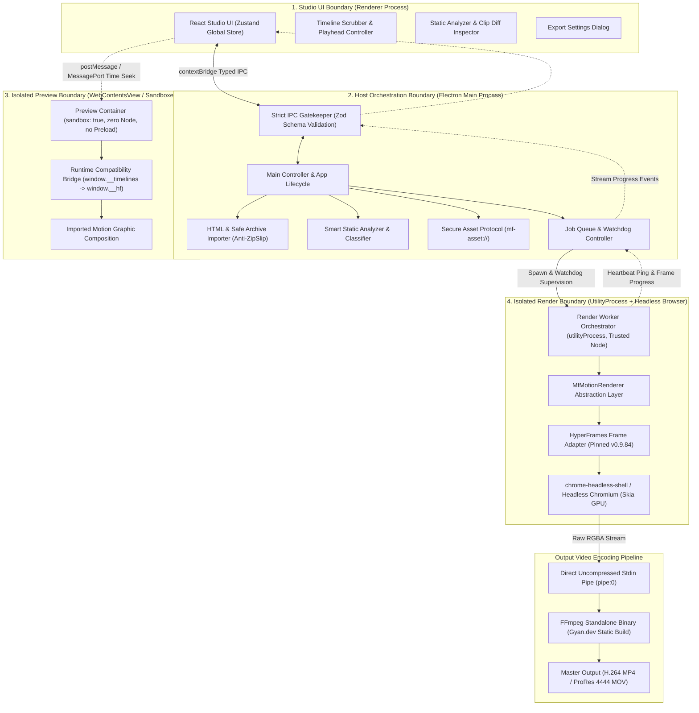
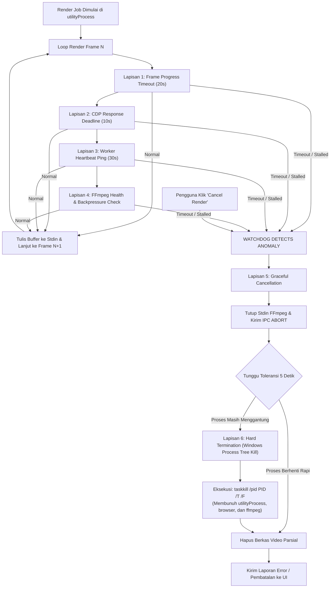

# MF Motion Gen 2.0 — Application Architecture Blueprint
## Phase 4: System Architecture & Subsystem Specification (Final Validation Draft)

**Dokumen:** Cetak Biru Arsitektur Aplikasi (Architecture Blueprint Final Validation Draft)  
**Tahap:** Phase 4 — Architecture & Design  
**Tanggal:** 24 November 2026  
**Penulis:** Antigravity (Implementation Engineer & Technical Researcher)  
**Reviewer:** ChatGPT (Project Manager & Technical Architect)  
**Persetujuan & Keputusan:** Product Owner (User)  
**Status Dokumen:** REVISED DRAFT FOR PM & PO REVIEW (Pending Validation Gate)

---

## Bagian Khusus: PM Review Corrections & Decision Status

Revisi ini menyelesaikan seluruh temuan akhir dari Project Manager (PM):
1. **Audit Metrik Paritas Visual & Rekonsiliasi Hasil Phase 3:**
   - Mengoreksi seluruh pelabelan metrik agar tidak terjadi kerancuan antara *Encoder Impact (ProRes-to-H.264)* dengan *End-to-End Drift (Preview-to-H.264)*.
   - Nilai **SSIM 0.9044 (PSNR 34.06 dB)** secara tepat dilabeli sebagai **[C] Preview-to-H.264 End-to-End Drift pada Round 1**, bukan komparasi ProRes-to-H.264 (yang bernilai **SSIM 0.9126 / PSNR 38.18 dB**).
   - Menyajikan hasil pengujian **Round 1 (NEXUS 1080p30)** dan **Round 2 (Breaking News 576p@30fps)** secara terpisah dengan pasangan sumber dan output yang eksplisit tanpa memaksakan satu ambang batas universal fiktif.
   - *Status: Proposed (Menunggu Persetujuan PM & PO).*
2. **Penyempurnaan Compatibility Bridge & Kontrak `window.__hf`:**
   - Memverifikasi kontrak dasar Engine yang hanya mewajibkan properti `duration` (getter numerik detik) dan fungsi `seek(timeInSeconds)`. Properti `media` diperlakukan sebagai integrasi opsional terpisah jika komposisi memuat elemen multimedia lokal.
   - Menangani pendaftaran timeline yang tertunda (*late timeline registration*) secara eksplisit via getter/setter trap dan listener siklus dokumen.
   - Mengevaluasi parameter `suppressEvents = true` pada `.seek()` serta menjelaskan konsekuensi terhadap animasi yang mengandalkan callback GSAP.
   - Menolak asumsi bahwa seluruh animasi GSAP otomatis kompatibel; jika struktur timeline ambigu, sistem mengeluarkan status `[WARNING: UNSUPPORTED / AMBIGUOUS TIMELINE / CALLBACK DEPENDENCY]`.
   - Mengeliminasi modifikasi visibilitas manual elemen `.clip` sebelum validasi empiris di Milestone 4.1.
   - *Status: Proposed (Menunggu Persetujuan PM & PO).*
3. **Re-evaluasi Preview Container Isolation:**
   - Membandingkan secara objektif Sandboxed Iframe (berbagi proses OS dengan UI) vs Dedicated `WebContentsView` (isolasi proses murni di level sistem operasi).
   - Menegaskan bahwa keputusan final menanti hasil **Security Spike 4.2**.
   - *Status: Pending Validation Gate (Security Spike 4.2).*
4. **Sistem Watchdog 6 Lapis & Terminasi Pohon Proses Windows:**
   - Mengoreksi penulisan API Electron: `utilityProcess.kill()` dipanggil tanpa argumen string sinyal.
   - Menghapus pemanggilan POSIX `process.kill('SIGKILL')` yang tidak valid di Windows.
   - Merancang mekanisme terminasi pohon proses Windows (*Windows Process Tree Kill*) menggunakan `taskkill /pid <PID> /T /F` yang mencakup worker, browser headless, dan ffmpeg.
   - Mengklarifikasi bahwa `--max-old-space-size=4096` adalah kuota heap V8 Node, bukan batas memori total proses sistem.
   - *Status: Proposed (Menunggu Persetujuan PM & PO).*

---

## 1. Ikhtisar Arsitektur Sistem

MF Motion Gen 2.0 membagi tanggung jawab arsitektural menjadi **empat batas eksekusi (execution boundaries)** independen yang saling terisolasi:



---

## 2. Re-Evaluasi Kontainer Preview Studio: Sandboxed Iframe vs Dedicated WebContentsView

Terdapat kebutuhan fundamental untuk mengisolasi konten HTML/JS tidak tepercaya sekaligus mempertahankan performa interaktif timeline scrubbing yang mulus.

### 2.1 Komparasi Arsitektural Objektif
| Aspek Evaluasi | Opsi 1: Sandboxed `<iframe>` di Renderer | Opsi 2: Dedicated `WebContentsView` (Electron 30+) |
| :--- | :--- | :--- |
| **Isolasi Proses OS (*Process Isolation*)** | **TIDAK ADA ISOLASI PROSES:** Iframe dieksekusi di dalam *OS process* yang sama dengan Studio UI. Jika terjadi exploit memory corruption di Chromium, attacker berada di proses UI. | **ISOLASI PROSES PENUH:** Berjalan di dalam proses renderer Chromium terpisah di level OS dengan sandbox sistem operasi aktif. Kerusakan di preview tidak menyentuh proses UI. |
| **Keamanan Kontekstual (*Context Security*)** | Sangat baik di level browser web: atribut `sandbox="allow-scripts"` (tanpa `allow-same-origin`) mencegah akses ke DOM UI, storage lokal, atau navigasi luar. | Sangat baik di level platform: Memiliki `WebPreferences` mandiri (`nodeIntegration: false`, `contextIsolation: true`, zero preload). |
| **Komunikasi & Latensi Seeking** | **Sangat Cepat (Sub-millisecond):** Menggunakan `window.postMessage` langsung dari React UI ke window iframe. Mampu melayani timeline scrubbing 60 FPS tanpa jeda. | **Memerlukan Relay IPC:** Menggunakan IPC Main-ke-WebContents atau `MessagePort`. Berisiko mengalami overhead latensi relay saat playhead digeser cepat. |
| **Positioning & Layout DOM** | **Sangat Fleksibel:** Merupakan elemen DOM standar React. Mengikuti layout CSS Grid/Flexbox, zoom canvas, dan pan secara mulus. | **Manual / Koordinat Absolut:** Memerlukan sinkronisasi koordinat piksel manual via C++ layout API (`view.setBounds({ x, y, width, height })`). Rentan glitch visual saat panel di-resize cepat. |
| **Manajemen Siklus Hidup (*Lifecycle*)** | Terikat langsung pada lifecycle komponen React Viewport. Hancur otomatis saat tab/komposisi berganti. | Wajib dikelola secara manual oleh Main Process (`addChildView` / `removeChildView`). Berisiko memory leak jika tidak dihancurkan secara eksplisit. |

### 2.2 Rencana Validasi (*Security Spike 4.2*)
- **Status:** **Pending Validation Gate (Security Spike 4.2).**
- Keputusan final wadah preview ditentukan berdasarkan bukti empiris responsivitas scrubbing dan stabilitas layout `WebContentsView` pada prototipe Milestone 4.2.

---

## 3. Worker & Security Boundary Architecture

### 3.1 Penegasan Peran `utilityProcess`
Electron `utilityProcess` secara internal berjalan **dengan integrasi Node.js aktif** (`nodeIntegration: true`).
- **Aturan Batasan Mutlak:**
  1. `utilityProcess` **HANYA bertindak sebagai Trusted Render Orchestrator**.
  2. `utilityProcess` **DILARANG KERAS mengeksekusi konten HTML/JS impor secara in-process**.
  3. Tanggung jawab `utilityProcess` adalah: memanggil biner browser headless (`chrome-headless-shell`), membuka koneksi Chrome DevTools Protocol (CDP), menyuntikkan skrip adapter GSAP, menangkap frame RGBA via CDP `HeadlessExperimental.beginFrame`, dan mengalirkannya ke stdin `ffmpeg.exe`.

### 3.2 Sistem Watchdog Berlapis & Terminasi Pohon Proses Windows
Sistem pengawasan dirancang dinamis dengan **6 lapisan supervisi**:



#### Rincian 6 Lapisan Pengawasan:
1. **Lapisan 1 — Frame Progress Timeout (20 Detik):** Jika proses rendering sebuah frame tunggal melebihi 20 detik, sistem menandai indikasi animasi macet (*hanging shader* atau *infinite loop*).
2. **Lapisan 2 — CDP Response Deadline (10 Detik):** Jika perintah `HeadlessExperimental.beginFrame` tidak merespons dalam 10 detik, koneksi CDP dianggap tidak responsif.
3. **Lapisan 3 — Worker Heartbeat Ping (30 Detik):** Main Process memantau sinyal detak jantung worker setiap 5 detik. Jika worker tidak mengirim kabar dalam 30 detik, watchdog dipicu.
4. **Lapisan 4 — FFmpeg Process Health & Pipe Backpressure:** Memantau kapasitas buffer pipa stdin `pipe:0`. Jika stream tertahan dan tidak mengalirkan event `drain` dalam 15 detik, proses encoder dianggap deadlock.
5. **Lapisan 5 — Graceful Cancellation:** Menutup stream stdin FFmpeg secara tertib dan mengirim pesan pembatalan ke worker dengan toleransi 5 detik.
6. **Lapisan 6 — Hard Termination (Windows Process Tree Kill):**
   - **Koreksi API Electron:** `utilityProcess.kill()` dipanggil tanpa argumen sinyal string.
   - **Solusi Terminasi Windows:** Main Process mengeksekusi `taskkill /pid <PID> /T /F` untuk membunuh seluruh hierarki proses secara bersih.
7. **Klarifikasi Batas Memori:** Argumen `--max-old-space-size=4096` pada worker adalah **kuota heap V8 Node**, bukan batas total RAM fisik sistem atau proses tree. Pemantauan memori proses dilakukan terpisah.

---

## 4. Arsitektur Kompatibilitas HTML / GSAP Authoring

### 4.1 Prinsip Desain: Kepatuhan Empiris
Berdasarkan bukti empiris Phase 3:
1. Komposisi Gemini AI Studio mendaftarkan master timeline pada `window.__timelines["main"]` dalam keadaan `paused: true`.
2. Elemen persisten (seperti globe SVG dan continuous ticker) **tidak memerlukan atribut `class="clip"`**.
3. HyperFrames upstream mendefinisikan protokol seeking resmi via objek global `window.__hf`.

### 4.2 Desain Compatibility Adapter (`GeminiToHyperFramesAdapter`)
Adapter disuntikkan ke dokumen sebelum rendering dimulai:
```typescript
export interface IMotionSeekContract {
  duration: number; // getter dalam satuan detik
  seek(timeInSeconds: number): void;
  media?: HTMLElement[]; // integrasi opsional untuk elemen media lokal
}
```

#### Siklus Hidup Penemuan & Penanganan Ambiguitas:
1. **Penanganan Pendaftaran Tertunda (*Late Registration Trap*):** Menggunakan getter/setter interceptor pada `window.__timelines` agar dapat menangkap timeline yang didefinisikan setelah script adapter disuntikkan.
2. **Prioritas Penemuan:**
   - Deteksi `window.__timelines && window.__timelines["main"]`.
   - Deteksi `window.timeline && typeof window.timeline.seek === "function"`.
3. **Peringatan Timeline/Callback Ambigu:**
   - Adapter **tidak secara otomatis memilih `gsap.globalTimeline`** karena risiko mengendalikan tween internal yang keliru.
   - Jika master timeline tidak ditemukan atau memiliki callback yang tidak idempoten, adapter mengeluarkan status: `[WARNING: UNSUPPORTED / AMBIGUOUS TIMELINE / CALLBACK DEPENDENCY]`.
4. **Semantik Elemen `.clip`:**
   - Draf arsitektur ini **tidak memanipulasi visibilitas `.clip` secara manual**. Seluruh elemen persisten dibiarkan tampil alami sesuai tata letak DOM aslinya hingga validasi siklus hidup selesai diuji pada Milestone 4.1.

---

## 5. Kriteria Kualitas Render Bertingkat (*Tiered Quality Acceptance Criteria*)

Kriteria kualitas dipisahkan berdasarkan bukti empiris aktual Phase 3 untuk masing-masing benchmark secara terpisah:

### 5.1 Baseline Empiris Round 1 — NEXUS Benchmark (1080p30, 240 Frame, Durasi 8.00 Detik)
Evaluasi diuji pada 7 frame sampel representatif ($F_0, F_{30}, F_{120}, F_{186}, F_{210}, F_{233}, F_{239}$) berdasarkan laporan resmi `POC_FINAL_REVIEW.md`:

| Metrik Evaluasi | Pasangan Sumber & Output | Rata-Rata SSIM | Rata-Rata PSNR | Rentang Nilai Teruji | Interpretasi & Status Kualitas |
| :--- | :--- | :---: | :---: | :---: | :--- |
| **[A] Renderer Parity** | **Chromium Preview Frame (GUI)** vs **ProRes 4444 Mezzanine Master** | **0.9879** | **36.75 dB** | SSIM: 0.9858 – 0.9949<br>PSNR: 33.14 – 53.40 dB | **PASS:** Paritas visual sangat tinggi. 98.89% piksel berada dalam toleransi sub-piksel $\Delta \le 5$. |
| **[B] Encoder Impact** | **ProRes 4444 Mezzanine Master** vs **H.264 MP4 Export (CRF 16)** | **0.9126** | **38.18 dB** | SSIM: 0.9076 – 0.9369<br>PSNR: 36.90 – 44.68 dB | **PASS:** Penurunan nilai SSIM wajar akibat chroma subsampling YUV420p pada teks halus 1080p. |
| **[C] End-to-End Drift**| **Chromium Preview Frame (GUI)** vs **H.264 MP4 Export** | **0.9044** | **34.06 dB** | SSIM: 0.8981 – 0.9355<br>PSNR: 31.83 – 44.48 dB | **PENDING PO ACCEPTANCE:** Nilai gabungan renderer dan kompresi encoder. Visual identik tanpa komposisi drift. |
| **Alpha Integrity** | **Raw Buffer Alpha** vs **ProRes 4444 Alpha Plane** | **1.000000** | **Inf dB** | Bit-Exact 100% | **PASS:** Kanal transparansi alpha terbukti mathematically lossless. |

---

### 5.2 Baseline Empiris Round 2 — Breaking News Benchmark (576p@30fps, 300 Frame, Durasi 10.00 Detik)
Evaluasi diuji pada 9 frame sampel representatif ($F_0, F_{30}, F_{60}, F_{90}, F_{150}, F_{240}, F_{270}, F_{285}, F_{299}$) berdasarkan laporan resmi `POC_ROUND2_REPORT.md`:

| Metrik Evaluasi | Pasangan Sumber & Output | Rata-Rata SSIM | Rata-Rata PSNR | Karakteristik Deviasi & Temuan | Status Evaluasi |
| :--- | :--- | :---: | :---: | :--- | :--- |
| **Deterministic Seek** | **Forward Seek** vs **Backward / Random Seek** | **0.9999** | **61.35 dB** | **6/9 frame bit-exact (1.000000)**. 3 frame ticker (F90, F150, F240) mencatat deviasi mikro SSIM 0.9997–0.9998 akibat pembulatan sub-piksel Skia. | **PASS** |
| **Renderer Parity** | **Chromium Preview Frame (GUI)** vs **ProRes 4444 Mezzanine Master** | **0.9319** | **25.19 dB** | 94.57% piksel dalam toleransi $\Delta \le 5$. Deviasi terkonsentrasi pada pergeseran 1px border putih skew CSS (`border: 3.5px solid #ffffff`, `skewX(-11deg)`). | **PASS WITH CAVEAT** |
| **Encoder Parity** | **ProRes 4444 Mezzanine Master** vs **H.264 MP4 Export** | **0.9789** | **41.36 dB** | 98.35% piksel dalam toleransi $\Delta \le 5$. Kompresi sangat stabil dan visual jernih. | **PASS** |
| **Reference Visual** | **H.264 MP4 Export** vs **Video Referensi Gemini AI Studio 576p** | **0.5830** | **13.56 dB** | Koreografi dan timing identik; selisih skor disebabkan oleh black fade-in detik 0 pada referensi dan perbedaan resolusi. | **PENDING PO ACCEPTANCE** |

---

## 6. Smart Static Analyzer & Scoped Auto-Fix Architecture

Untuk mencegah kerusakan animasi yang disengaja, **Static Analyzer dilarang keras memperpanjang durasi seluruh elemen clip secara membabi buta (*no blind auto-extend*)**.

### 6.1 Sistem Klasifikasi Elemen 5 Kategori
Setiap elemen di dalam dokumen HTML yang diimpor diklasifikasikan ke dalam salah satu kategori:
1. **Persistent Visual Element:** Elemen kontainer, latar belakang, bingkai stasiun, kanvas utama, atau teks berjalan yang tidak memiliki atribut transien. *Tindakan: Pertahankan durasi penuh, jangan ubah.*
2. **Transient Effect:** Elemen seperti kilatan cahaya (*lens flare*), ledakan partikel, atau badge sesaat yang sengaja berdurasi pendek (`data-duration="0.3"`). *Tindakan: Pertahankan durasi aslinya.*
3. **Timeline-Controlled Element:** Elemen dengan durasi clip pendek (`data-duration="0.5"`), namun timeline GSAP membiarkannya tetap terlihat permanen hingga detik ke-8/10 tanpa tween keluar. *Tindakan: Tandai sebagai kandidat tinjauan auto-fix.*
4. **Media Element:** Elemen `<audio>` atau `<video>`. *Tindakan: Verifikasi ketersediaan berkas media lokal.*
5. **Unsupported / Ambiguous Element:** Elemen dengan script inline non-standar, timer dinding (`setInterval`), atau event listener interaktif. *Tindakan: Tampilkan peringatan diagnostik kepada pengguna.*

### 6.2 Aturan Auto-Fix Bersyarat & Preview Diff
Auto-fix hanya dapat diaktifkan jika kondisi berikut terpenuhi:
1. Elemen bertipe `Timeline-Controlled Element`.
2. Nilai `data-start + data-duration < compositionDuration`.
3. Kurva GSAP membuktikan visibilitas elemen dipertahankan hingga akhir durasi.
4. **Wajib Menampilkan Preview Code Diff:** Antarmuka studio wajib menampilkan dialog perbandingan baris kode (*side-by-side diff*) sebelum modifikasi diterapkan ke salinan kerja (*working copy*):
   ```diff
   - <div class="clip" data-start="0" data-duration="0.5" id="news-badge">
   + <div class="clip" data-start="0" data-duration="10.0" id="news-badge">
   ```
   Pengguna dapat memilih *"Terapkan Koreksi"* atau *"Abaikan"*. Berkas sumber asli tidak pernah dimodifikasi di disk.

---

## Ringkasan Status Keputusan Arsitektur Sistem

| Komponen Subsistem | Rekomendasi Teknis | Status Keputusan |
| :--- | :--- | :--- |
| **Preview Container Isolation** | Evaluasi Sandboxed Iframe vs Dedicated WebContentsView | **Pending Validation Gate (Security Spike 4.2)** |
| **Worker Execution Boundary** | `utilityProcess` sebagai Trusted Orchestrator murni | **Proposed (Menunggu Persetujuan PM & PO)** |
| **Watchdog Supervision** | 6-Tier Watchdog + Windows Process Tree Kill (`taskkill`) | **Proposed (Menunggu Persetujuan PM & PO)** |
| **GSAP Compatibility Bridge** | Base Contract `duration` & `seek(t)` dengan Late Registration Trap | **Proposed (Menunggu Persetujuan PM & PO)** |
| **Quality Acceptance Criteria** | Tiered Empirically-Validated Baseline (Round 1 & Round 2 terpisah) | **Proposed (Menunggu Persetujuan PM & PO)** |
| **Static Analyzer & Auto-Fix** | 5 Kategori Elemen + Scoped Side-by-Side Code Diff | **Proposed (Menunggu Persetujuan PM & PO)** |

---

## Daftar Risiko Teknis yang Belum Terselesaikan (*Unresolved Technical Risks*)

1. **Risiko 1 — Paritas Layout WebContentsView pada Jendela Dinamis:** WebContentsView memerlukan sinkronisasi manual koordinat piksel via `setBounds`, yang berisiko mengalami jeda atau glitch visual saat panel UI di-resize cepat.
2. **Risiko 2 — Efek CSS Skew pada Rasterisasi Skia GPU:** Ditemukan pada Round 2 bahwa kombinasi `skewX` dan border pecahan (`3.5px solid`) dapat memicu selisih rasterisasi 1 piksel antara preview GUI dan headless shell.
3. **Risiko 3 — Audio Drift pada Video Berdurasi Panjang:** Sinkronisasi audio mixing belum divalidasi secara empiris di Phase 3 dan memerlukan pengujian presisi di Milestone 4.1.
4. **Risiko 4 — Kompatibilitas Non-GSAP Authoring:** Komposisi yang menggunakan Canvas API langsung atau pustaka animasi selain GSAP memerlukan adapter khusus yang belum dirancang pada rilis ini.
