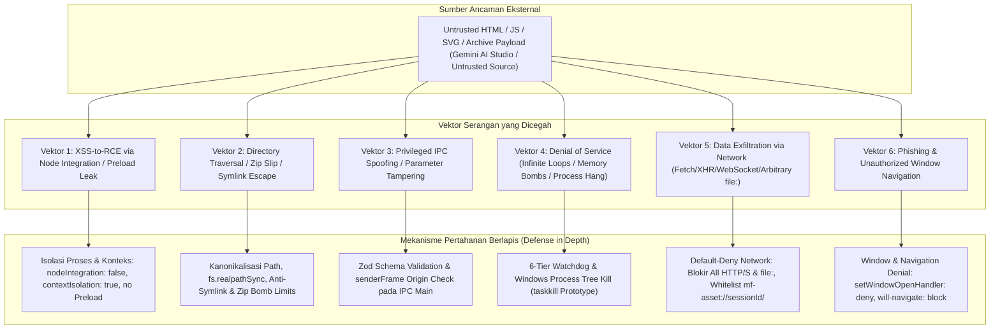
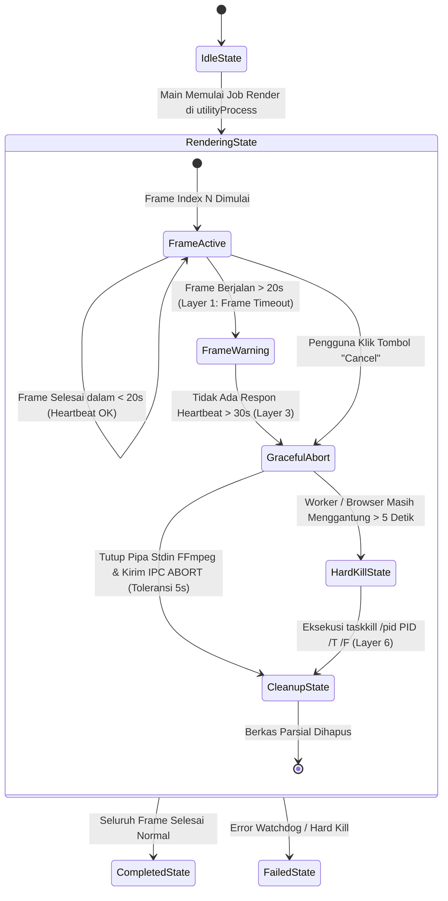

# MF Motion Gen 2.0 — Security Architecture & Threat Model
## Phase 4: Untrusted Content Isolation & Hardening Specification (Final Validation Draft)

**Dokumen:** Arsitektur Keamanan & Model Ancaman (Security Architecture & Threat Model Final Validation Draft)  
**Tahap:** Phase 4 — Architecture & Design  
**Tanggal:** 24 November 2026  
**Penulis:** Antigravity (Implementation Engineer & Technical Researcher)  
**Reviewer:** ChatGPT (Project Manager & Technical Architect)  
**Persetujuan & Keputusan:** Product Owner (User)  
**Status Dokumen:** REVISED DRAFT FOR PM & PO REVIEW (Pending Validation Gate)

---

## Bagian Khusus: PM Review Corrections & Decision Status

Revisi ini menyelesaikan seluruh temuan akhir dari Project Manager (PM):
1. **Koreksi Registrasi & Penegakan Skema Kustom Aset (`mf-asset://`):**
   - Mengganti properti `supportFetch` dengan nama API Electron resmi: **`supportFetchAPI: true`**.
   - Menegaskan bahwa `protocol.registerSchemesAsPrivileged()` **wajib dieksekusi secara sinkron sebelum `app.on('ready')`** (pada tingkat atas modul entry point main process), bukan di dalam callback ready.
   - Menyertakan privilege **`standard: true`** agar URL `mf-asset://` di-parsing sesuai standar URL web (mendukung resolusi path relatif seperti `href="styles.css"` atau `src="./logo.svg"`, query string, dan kanonikalisasi).
   - Menggunakan API resmi **`url.pathToFileURL()`** untuk konversi berkas lokal ke format URL yang aman.
   - Memperkuat containment path dengan **`fs.realpathSync()` / kanonikalisasi path sistem operasi** untuk mencegah pelarian symlink, tidak hanya mengandalkan pengecekan teks `startsWith()`.
   - Memvalidasi parameter host/session identifier pada URL: format diwajibkan berupa `mf-asset://<sessionId>/<relativePath>`, dan request ditolak jika `url.hostname` tidak sesuai dengan session ID aktif.
   - Menjelaskan bagaimana CSP mengizinkan pustaka GSAP lokal dan berkas JS terverifikasi via `mf-asset:` tanpa mengizinkan skrip remote dari internet.
   - *Status: Proposed (Menunggu Persetujuan PM & PO).*
2. **Koreksi Pemantauan Memori & Terminasi Pohon Proses Windows:**
   - Mengoreksi pernyataan keliru mengenai `process.memoryUsage.rss()`: RSS hanya memantau proses tunggal pemanggil, **bukan total process tree aplikasi**.
   - Mengadopsi **`app.getAppMetrics()`** untuk memantau metrik seluruh proses Electron terkait (Main, Renderer, dan `utilityProcess`).
   - Merancang pemantauan terpisah untuk proses anak eksternal non-Electron (`chrome-headless-shell.exe` dan `ffmpeg.exe`) via polling OS-level / Windows Management APIs.
   - Mempertahankan perbedaan tegas antara batas heap V8 (`--max-old-space-size=4096`) dan total konsumsi memori fisik (*working set*).
   - Mendokumentasikan `taskkill /pid <PID> /T /F` sebagai strategi prototipe terminasi Windows yang **wajib diuji secara empiris pada Security Spike 4.2**, dan menghapus klaim prematur bahwa terminasi pasti selesai dalam <6 detik sebelum terbukti.
   - *Status: Proposed (Menunggu Persetujuan PM & PO).*
3. **Re-evaluasi Preview Container Isolation:**
   - Membandingkan secara objektif Sandboxed Iframe (berbagi proses OS dengan UI) vs Dedicated `WebContentsView` (isolasi proses murni di level sistem operasi).
   - Menegaskan bahwa keputusan final menanti hasil **Security Spike 4.2**.
   - *Status: Pending Validation Gate (Security Spike 4.2).*
4. **Penguatan Ekstraksi Arsip ZIP (Deep Hardening Anti-ZipSlip):**
   - Menolak symbolic link & hardlink, menolak drive paths (`C:\...`) dan UNC paths (`\\server\...`), menormalkan separator Windows, mendeteksi entri duplikat *case-insensitive*, serta menegakkan batas kuota dekompresi *zip bomb*.
   - *Status: Proposed (Menunggu Persetujuan PM & PO).*

---

## 1. Prinsip Keamanan Dasar (*Core Security Principles*)

Sesuai ketentuan non-negosiasi pada `AGENTS.md`:
> *"Imported HTML, JavaScript, CSS, SVG, images, and archives are untrusted. Never expose Node, filesystem, shell, process, credentials, or privileged IPC to imported content. Do not treat a Web Worker or browser sandbox alone as a complete security strategy."*

Seluruh konten yang diimpor pengguna (termasuk kode HTML hasil AI Studio) **wajib diperlakukan sebagai muatan tidak tepercaya (*untrusted payload*)** yang berpotensi memuat skrip eksploitasi browser, teknik pelarian sandbox (*sandbox escape*), maupun serangan injeksi sistem operasi.

---

## 2. Model Ancaman & Vektor Serangan (*Threat Modeling*)



---

## 3. Rincian Batas Eksekusi & Isolasi (*Execution Boundaries*)

### 3.1 Boundary 1: Host Main Process (Privileged Zone)
- **Tingkat Kepercayaan:** Trusted.
- **Akses Sistem:** Memiliki akses ke Node.js runtime, sistem berkas lokal, pemanggilan biner `ffmpeg.exe`, dan jendela sistem operasi.
- **Kebijakan Keamanan:**
  - Bertindak sebagai gerbang (*gatekeeper*) tunggal yang memvalidasi seluruh input pengguna melalui Zod runtime validation.
  - Memeriksa asal frame pengirim pada setiap panggilan IPC (`event.senderFrame`).
  - Menolak seluruh permintaan navigasi yang tidak menuju ke berkas lokal terverifikasi.
  - Mematikan kemampuan devtools dan remote debugging pada build rilis produksi.

### 3.2 Boundary 2: Studio UI Renderer Process (Semi-Trusted Zone)
- **Tingkat Kepercayaan:** Trusted UI.
- **Akses Sistem:** Tidak memiliki akses langsung ke Node.js (`nodeIntegration: false`).
- **Kebijakan Keamanan:**
  - Hanya dapat berkomunikasi dengan Main Process melalui API typed yang diekspos secara ketat oleh `contextBridge` di skrip preload `src/preload/index.ts`.
  - Mengelola tampilan antarmuka React dan scrubber timeline.
  - Tidak mengeksekusi konten HTML impor di dalam konteks DOM-nya sendiri.

### 3.3 Boundary 3: Preview Container (Untrusted Zone)
- **Tingkat Kepercayaan:** UNTRUSTED.
- **Kandidat Wadah Eksekusi:**
  1. **Sandboxed `<iframe>`:** Atribut `sandbox="allow-scripts"` (tanpa `allow-same-origin`, tanpa `allow-top-navigation`, tanpa `allow-popups`). Berjalan di origin unik `null`. *Kelemahan:* Berbagi proses OS dengan UI Renderer.
  2. **Dedicated `WebContentsView`:** Memiliki proses renderer OS terpisah murni di luar UI Studio dengan `WebPreferences` mandiri. *Kelebihan:* Isolasi proses sistem operasi murni.
- **Keputusan Final:** Bergantung pada hasil **Security Spike 4.2**.
- **Kebijakan Keamanan Bersama:**
  - **Zero Preload Exposure:** Kontainer preview **SAMA SEKALI TIDAK DIBEKALI PRELOAD SCRIPT**. Variabel global seperti `window.api`, `window.electron`, `require`, atau `process` bernilai `undefined`.
  - **Zero Node Access:** Berjalan murni di bawah lingkungan browser web standar.
  - **Zero IPC Capability:** Tidak memiliki akses ke `ipcRenderer`. Komunikasi dari Studio UI ke preview hanya menggunakan messaging satu arah dengan payload waktu: `{ type: 'SEEK', time: 3.5 }`.
  - **Larangan Akses Arbitrer `file:`:** Seluruh aset lokal hanya dilayani melalui protokol terisolasi `mf-asset://<sessionId>/...`.

### 3.4 Boundary 4: Render Worker (`utilityProcess` & Headless Browser)
- **Tingkat Kepercayaan:** Trusted Orchestrator + Untrusted Browser Execution.
- **Mekanisme Kerja:**
  - `utilityProcess` berjalan dengan Node.js aktif untuk memanggil child process biner browser dan biner FFmpeg.
  - Konten HTML/JS impor **DILARANG KERAS dieksekusi di dalam Node runtime `utilityProcess`**.
  - `utilityProcess` menginstruksikan `chrome-headless-shell` via Chrome DevTools Protocol (CDP) untuk memuat HTML di dalam browser headless terisolasi dengan flag keamanan sandbox aktif (`--enable-sandbox`, `--disable-web-security=false`).
  - Browser headless menangkap frame gambar mentah RGBA via `HeadlessExperimental.beginFrame` dan mengalirkannya langsung ke stdin pipe `ffmpeg.exe`.

---

## 4. Kebijakan Keamanan Jaringan, Skema Kustom & File System

### 4.1 Kebijakan Akses Jaringan Terpusat (*Default-Deny Network Policy*)
Komposisi motion graphic yang diimpor wajib bersifat mandiri (*offline-ready*).  
Skema `file:` **DILARANG untuk konten impor** guna mencegah pembacaan berkas sensitif lokal (`file:///C:/Users/...`). Hanya protokol kustom terverifikasi `mf-asset://<sessionId>/...` dan skema internal `data:` / `blob:` yang diizinkan:

```typescript
// src/main/security/networkPolicy.ts
import { session } from 'electron';

export function enforceNetworkPolicy(ses: Electron.Session, activeSessionId: string): void {
  ses.webRequest.onBeforeRequest({ urls: ['*://*/*'] }, (details, callback) => {
    const urlString = details.url;

    // Izinkan skema internal browser yang aman
    if (urlString.startsWith('data:') || urlString.startsWith('blob:')) {
      return callback({ cancel: false });
    }

    // Validasi skema kustom aset lokal
    if (urlString.startsWith('mf-asset:')) {
      try {
        const parsedUrl = new URL(urlString);
        // Validasi host identifier wajib cocok dengan sesi aktif
        if (parsedUrl.hostname === activeSessionId) {
          return callback({ cancel: false });
        }
      } catch {
        // URL malformed, batalkan request
      }
    }

    // Blokir seluruh protokol lain (http:, https:, ftp:, dan arbitrary file:)
    console.warn(`[SECURITY VIOLATION] Blocked outbound network request: ${urlString} (Type: ${details.resourceType})`);
    return callback({ cancel: true });
  });
}
```

### 4.2 Registrasi & Penanganan Skema Kustom Aman (`mf-asset://`)

#### Registrasi Sinkron Sebelum App Ready:
Sesuai dokumentasi resmi Electron, `protocol.registerSchemesAsPrivileged` **wajib dipanggil secara sinkron sebelum event `app.on('ready')`**:
```typescript
// src/main/security/registerProtocols.ts
import { protocol } from 'electron';

export function registerCustomSchemes(): void {
  protocol.registerSchemesAsPrivileged([
    {
      scheme: 'mf-asset',
      privileges: {
        standard: true,       // Mengizinkan parsing URL standar & resolusi path relatif (./logo.svg)
        secure: true,         // Diperlakukan sebagai origin aman (mendukung HTTPS-like semantics)
        supportFetchAPI: true,// Mengizinkan pemanggilan via fetch() di dalam sandbox
        corsEnabled: true,    // Mengizinkan CORS header untuk local web font dan media
        stream: true          // Mengizinkan streaming video/audio chunked
      }
    }
  ]);
}
```

#### Penanganan Request & Verifikasi Containment Path Menggunakan `realpath`:
```typescript
// src/main/security/assetProtocolHandler.ts
import { session, net } from 'electron';
import { pathToFileURL } from 'node:url';
import path from 'node:path';
import fs from 'node:fs';

export function setupAssetProtocolHandler(ses: Electron.Session, activeSessionId: string, sessionRootDir: string): void {
  // Dapatkan canonical path dari root direktori sesi
  const canonicalSessionRoot = fs.realpathSync(path.resolve(sessionRootDir));

  ses.protocol.handle('mf-asset', async (request) => {
    try {
      const url = new URL(request.url);

      // 1. Validasi host identifier sesi
      if (url.hostname !== activeSessionId) {
        console.error(`[SECURITY] Invalid session host identifier: ${url.hostname} (Expected: ${activeSessionId})`);
        return new Response('Access Denied: Invalid Session Identifier', { status: 403 });
      }

      // 2. Decode dan normalisasi pathname
      const decodedPath = decodeURIComponent(url.pathname);
      const safeRelativePath = path.normalize(decodedPath).replace(/^(\.\.[\/\\])+/, '').replace(/^[\/\\]/, '');
      const candidatePath = path.resolve(canonicalSessionRoot, safeRelativePath);

      // 3. Verifikasi ketersediaan berkas fisik
      if (!fs.existsSync(candidatePath)) {
        return new Response('File Not Found', { status: 404 });
      }

      // 4. Verifikasi symlink & containment path mutlak
      const canonicalFilePath = fs.realpathSync(candidatePath);
      const lstat = fs.lstatSync(candidatePath);

      // Tolak symlink jika mengarah ke luar root direktori sesi
      if (lstat.isSymbolicLink() || !canonicalFilePath.startsWith(canonicalSessionRoot + path.sep)) {
        console.error(`[SECURITY] Symlink traversal attempt detected: ${candidatePath} -> ${canonicalFilePath}`);
        return new Response('Access Denied: Symlink Escape Detected', { status: 403 });
      }

      // 5. Konversi path sistem operasi ke format file URL resmi via pathToFileURL
      const fileUrl = pathToFileURL(canonicalFilePath).toString();

      // 6. Sajikan berkas dengan header CORS yang tepat
      return await net.fetch(fileUrl, {
        headers: {
          'Access-Control-Allow-Origin': '*',
          'Content-Security-Policy': "default-src 'none'"
        }
      });
    } catch (err) {
      console.error('[SECURITY] Error resolving asset:', err);
      return new Response('Internal Security Error', { status: 500 });
    }
  });
}
```

### 4.3 Content Security Policy (CSP) Response Headers & Pemuatan GSAP Lokal
Setiap respon dokumen HTML yang disajikan ke lingkungan preview dan render menyertakan header CSP ketat:
```text
default-src 'none';
script-src 'unsafe-inline' mf-asset:;
style-src 'unsafe-inline' mf-asset:;
img-src data: blob: mf-asset:;
font-src data: mf-asset:;
media-src mf-asset:;
connect-src 'none';
frame-src 'none';
object-src 'none';
base-uri 'none';
form-action 'none';
```
- **Mekanisme Pemuatan GSAP Lokal:** Pustaka vendor `gsap.min.js` disajikan secara lokal melalui skema `mf-asset://<sessionId>/vendor/gsap.min.js`. Kebijakan `script-src 'unsafe-inline' mf-asset:` mengizinkan eksekusi script lokal tersebut, sementara `connect-src 'none'` dan blokir jaringan pada `onBeforeRequest` menjamin tidak ada skrip remote dari CDN eksternal yang dapat diunduh.

### 4.4 Penguatan Ekstraksi Arsip ZIP (*Deep Hardening Anti-ZipSlip*)
Saat pengguna mengimpor arsip `.zip` proyek:
1. Berkas diekstraksi ke direktori terisolasi: `%TEMP%/mf-motion-gen/<session-uuid>/`.
2. **Pemeriksaan Keamanan Ekstraksi Berlapis:**
   - **Tolak Symlink & Hardlink:** Periksa atribut entri arsip. Jika entri merupakan tautan simbolik (*symbolic link*) atau *hard link*, proses impor **wajib dibatalkan** untuk mencegah tautan mengarah ke berkas sistem di luar sandbox.
   - **Tolak Drive Path Absolut & UNC Path:** Entri yang diawali dengan huruf drive (`C:\`, `D:\`) atau path jaringan Windows UNC (`\\server\share`) ditolak seketika.
   - **Normalisasi Path Windows:** Seluruh separator `/` dan `\` dikonversi secara konsisten, dan karakter berbahaya pada akhir nama berkas Windows (seperti trailing dots `.` atau trailing spaces ` ` yang diabaikan oleh Windows file system) ditolak.
   - **Tolak Entri Duplikat Case-Insensitive:** Windows file system bersifat *case-insensitive*. Jika arsip memuat `image.png` dan `IMAGE.PNG`, ekstraktor menolak impor untuk mencegah serangan penimpaan file tak terduga (*unexpected overwrite attack*).
   - **Zip Bomb Decompression Limits:**
     - Maksimum rasio kompresi: **100:1** (jika ukuran uncompressed dibagi compressed melebihi 100, batalkan).
     - Maksimum jumlah berkas dalam satu arsip: **1.000 berkas**.
     - Maksimum ukuran total uncompressed: **500 MB**.

---

## 5. Pemantauan Memori Proses & Terminasi Pohon Proses Windows

### 5.1 Arsitektur Pemantauan Memori Multi-Proses

#### 1. Pemantauan Proses Electron via `app.getAppMetrics()`:
Panggilan `process.memoryUsage.rss()` hanya membaca konsumsi memori proses yang mengeksekusinya. Untuk memantau seluruh proses internal Electron, Main Process menggunakan:
```typescript
import { app } from 'electron';

export function getElectronProcessesMemory(): Array<{ pid: number; type: string; memoryKB: number }> {
  const metrics = app.getAppMetrics();
  return metrics.map(m => ({
    pid: m.pid,
    type: m.type, // 'Browser', 'Tab', 'Utility', 'GPU'
    memoryKB: m.memory.workingSetSize
  }));
}
```

#### 2. Pemantauan Proses Anak Eksternal (`chrome-headless-shell` dan `ffmpeg.exe`):
Biner `chrome-headless-shell.exe` dan `ffmpeg.exe` berjalan sebagai child processes sistem operasi di luar ekosistem Electron. Pemantauannya dilakukan secara terpisah melalui OS management APIs:
- Pada platform Windows, Main Process memantau PID child process melalui perintah native `Get-Process -Id <pid>` atau native bindings Win32 `GetProcessMemoryInfo`.
- **Pemisahan Batas Memori:** Batas alokasi heap V8 (`--max-old-space-size=4096`) hanya membatasi alokasi JavaScript engine Node pada worker, bukan batas memori total proses sistem operasi (*working set memory*).

### 5.2 Sistem Watchdog Berlapis & Prototipe Terminasi Windows



#### Rincian 6 Lapisan Pengawasan:
1. **Lapisan 1 (Frame Progress Timeout - 20s):** Mendeteksi frame tunggal yang membutuhkan waktu lebih dari 20 detik untuk dirender.
2. **Lapisan 2 (Browser CDP Deadline - 10s):** Mendeteksi perintah CDP `HeadlessExperimental.beginFrame` yang tidak merespons dalam 10 detik.
3. **Lapisan 3 (Worker Heartbeat Ping - 30s):** Worker wajib mengirimkan event detak jantung ke Main Process minimal setiap 5 detik. Jika 30 detik berlalu tanpa kabar, worker dianggap macet (*hung*).
4. **Lapisan 4 (FFmpeg Health & Backpressure Check):** Memantau status stream stdin FFmpeg. Jika backpressure buffer tertahan lebih dari 15 detik tanpa event `drain`, encoder dianggap deadlock.
5. **Lapisan 5 (Graceful Cancellation):** Mengirim pesan pembatalan ke worker dan menutup pipa FFmpeg dengan jeda toleransi 5 detik.
6. **Lapisan 6 (Hard Termination via Windows Process Tree Kill):**
   - **Koreksi API:** `utilityProcess.kill()` dipanggil tanpa argumen sinyal string.
   - **Prototipe Terminasi Windows:** Untuk memastikan seluruh child process (`chrome-headless-shell.exe` dan `ffmpeg.exe`) mati sempurna tanpa meninggalkan proses zombie di Windows, Main Process mengeksekusi:
     $$\text{taskkill /pid } \langle\text{worker.pid}\rangle \text{ /T /F}$$
   - *Catatan Pengujian:* Efektivitas dan kecepatan terminasi `taskkill` wajib diuji secara empiris menggunakan pohon proses riil pada Security Spike 4.2.

---

## 6. Rencana Validasi Pengujian Keamanan Phase 4 (*Milestone 4.2 Security Test Suites*)

| Kode Test Suite | Target Validasi | Metodologi Pengujian | Hasil yang Diharapkan |
| :--- | :--- | :--- | :--- |
| **Test Suite 4.2-A** | Isolasi Node.js (`require`) | Muat payload HTML yang mengeksekusi `typeof require`, `typeof process`, dan `typeof Buffer`. | Bernilai `undefined` 100%. |
| **Test Suite 4.2-B** | Isolasi Preload Bridge | Muat skrip di preview yang memanggil `window.api` atau `window.electron`. | Bernilai `undefined` 100%. |
| **Test Suite 4.2-C** | Penolakan Jaringan & `file:` | Muat skrip yang mengeksekusi `fetch('https://google.com')` dan `fetch('file:///C:/Windows/win.ini')`. | Request dibatalkan seketika dan promise reject. |
| **Test Suite 4.2-D** | Deep Anti-ZipSlip | Impor arsip ZIP yang memuat symlink eksternal, drive path `C:\evil.bat`, dan entri traversal `../../poc.txt`. | Ekstraksi ditolak seketika dengan `SecurityError`. |
| **Test Suite 4.2-E** | Zip Bomb Protection | Impor arsip sintetik dengan rasio kompresi 200:1 atau ukuran uncompressed > 500 MB. | Ditolak sebelum dekompresi selesai. |
| **Test Suite 4.2-F** | Windows Process Tree Kill | Picu render video dengan infinite loop JavaScript, lalu uji pembatalan darurat via `taskkill`. | Ukur waktu terminasi aktual dan buktikan tidak ada child process yang tertinggal di task manager. |

---

## Ringkasan Status Keputusan Arsitektur Keamanan

| Domain Keamanan | Rekomendasi Teknis | Status Keputusan |
| :--- | :--- | :--- |
| **Preview Container Isolation** | Evaluasi Sandboxed Iframe vs Dedicated WebContentsView | **Pending Validation Gate (Security Spike 4.2)** |
| **Network & File Access** | Default-Deny (Blokir HTTP/S & `file:`, Whitelist `mf-asset://sessionId/`) | **Proposed (Menunggu Persetujuan PM & PO)** |
| **Worker Boundary** | `utilityProcess` sebagai Trusted Orchestrator murni | **Proposed (Menunggu Persetujuan PM & PO)** |
| **Watchdog & Process Kill** | 6-Tier Watchdog + Windows Process Tree Kill (`taskkill` Prototype) | **Proposed (Menunggu Persetujuan PM & PO)** |
| **Archive Import Hardening**| Deep Anti-ZipSlip (No Symlink, Normalization, Bomb Limits) | **Proposed (Menunggu Persetujuan PM & PO)** |

---

## Daftar Risiko Teknis yang Belum Terselesaikan (*Unresolved Technical Risks*)

1. **Risiko 1 — Keandalan `taskkill` pada Windows:** Pemanggilan `taskkill /pid <PID> /T /F` bergantung pada perintah eksternal Windows shell. Perlu diuji apakah antivirus pihak ketiga atau kebijakan izin pengguna memblokir pemanggilan ini.
2. **Risiko 2 — Overhead IPC Relay pada WebContentsView:** Jika WebContentsView dipilih pada Milestone 4.2, latensi komunikasi seeking relay via Main Process harus diuji agar tidak menimbulkan lag visual pada timeline scrubbing 60 FPS.
3. **Risiko 3 — Eksfiltrasi Aset Lokal via Skema Kustom:** Validasi host identifier `sessionId` wajib dipastikan tidak dapat dipalsukan oleh dokumen HTML yang mencoba menerobos origin sandbox.
