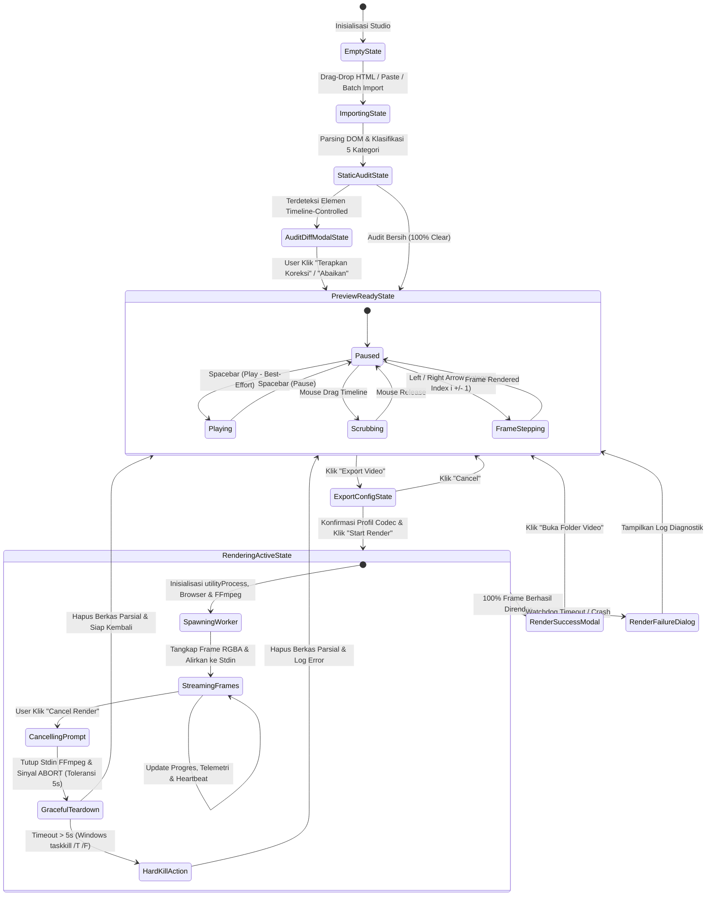

# MF Motion Gen 2.0 — UI/UX Studio Blueprint
## Phase 4: Desktop Studio Layout & Interaction Specification (Final Validation Draft)

**Dokumen:** Cetak Biru Antarmuka Pengguna & Pengalaman Pengguna (UI/UX Blueprint Final Validation Draft)  
**Tahap:** Phase 4 — Architecture & Design  
**Tanggal:** 24 November 2026  
**Penulis:** Antigravity (Implementation Engineer & Technical Researcher)  
**Reviewer:** ChatGPT (Project Manager & Technical Architect)  
**Persetujuan & Keputusan:** Product Owner (User)  
**Status Dokumen:** REVISED DRAFT FOR PM & PO REVIEW (Pending Validation Gate)

---

## Bagian Khusus: PM Review Corrections & Decision Status

Revisi ini menyelesaikan seluruh temuan akhir dari Project Manager (PM):
1. **Koreksi Pemetaan Profil Codec Apple ProRes (`prores_ks`):**
   - Mengoreksi mapping nilai profil FFmpeg `prores_ks` agar tidak ada duplikasi Profile 4:
     - **`profile:v 3`**: Apple ProRes 422 HQ (Broadcast standard, tanpa alpha).
     - **`profile:v 4`**: Apple ProRes 4444 (Master mezzanine dengan transparansi alpha channel).
     - **`profile:v 5`**: Apple ProRes 4444 XQ (Kualitas mastering visual tertinggi dengan alpha channel).
   - *Status: Proposed (Menunggu Persetujuan PM & PO).*
2. **Definisi Presisi Frame Boundary & Integer Frame Stepping:**
   - Menetapkan **integer frame index sebagai sumber kebenaran utama (*primary source of truth*)** untuk seluruh operasi seeking dan playback transport bar:
     $$i_{\text{new}} = \text{clamp}(i \pm 1, \ 0, \ N - 1)$$
     $$t_{\text{seek}} = \frac{i_{\text{new}}}{\text{FPS}}$$
   - Menegaskan batas-batas matematis:
     - Frame Index (Zero-based): $i \in \{0, 1, 2, \dots, N - 1\}$.
     - Index frame terakhir yang valid: $i_{\text{last}} = N - 1$.
     - Timestamp frame terakhir: $t_{\text{last}} = (N - 1) / \text{FPS}$.
     - Durasi komposisi ($t_{\text{duration}}$) adalah **exclusive end boundary**, bukan timestamp frame terakhir.
   - Menjelaskan penghitungan total frame $N$: diperoleh dari metadata dokumen jika dideklarasikan, atau dihitung via $N = \text{round}(t_{\text{duration}} \times \text{FPS})$.
   - Mendukung perhitungan rasional untuk framerate standar broadcast NTSC ($29.97\text{ FPS} = 30000/1001$ dan $59.94\text{ FPS} = 60000/1001$) guna mencegah drift waktu akumulatif floating point.
   - *Status: Proposed (Menunggu Persetujuan PM & PO).*
3. **Penyempurnaan Kontrol Kualitas Codec & Terminasi Parameter:**
   - Menegaskan bahwa slider CRF hanya aktif untuk codec berbasis CRF (H.264 / VP9); untuk ProRes, kontrol kualitas beralih otomatis ke seleksi profil `prores_ks`.
   - Mengoreksi deskripsi CRF 14 menjadi **"Near-Lossless High Bitrate Preset"** (menghapus klaim jaminan visual lossless mutlak).
   - Mengganti istilah "Pixel-Exact" menjadi **"1:1 Native Scale (100%)"**.
   - *Status: Proposed (Menunggu Persetujuan PM & PO).*
4. **Pembersihan Status Bar & Snapping Magnetik Bersyarat:**
   - Mengganti angka status dummy prematur pada StatusBar dengan slot metrik telemetri yang akan dihubungkan ke `app.getAppMetrics()` dan event runtime worker.
   - Menetapkan bahwa *snap-to-keyframe* hanya aktif jika keyframe/marker durasi benar-benar terdeteksi dari metadata timeline GSAP.
   - Mendukung alur kerja impor batch HTML dan folder proyek dengan aset tertaut (*linked asset folders*).
   - *Status: Proposed (Menunggu Persetujuan PM & PO).*

---

## 1. Filosofi & Pedoman Desain Visual

MF Motion Gen 2.0 dirancang sebagai studio desktop motion graphics broadcast yang menggabungkan kemudahan alur kerja berbasis web dengan ketepatan teknis perangkat lunak video editing profesional:
- **Tema Gelap Sinematik (*Cinematic Dark Theme*):** Memanfaatkan palet warna Slate-900 (`#0f172a`) dan Slate-950 (`#020617`) dengan aksen Cyan Neon (`#00f0ff`), Amber Warning (`#f59e0b`), dan Emerald Success (`#10b981`).
- **Determinisme Visual Mutlak:** Setiap perubahan nilai playhead waktu pada viewport studio mencerminkan frame animasi secara tepat tanpa jeda interpolasi atau pergeseran geometri teks.
- **Transparansi Non-Destruktif:** Berkas asli dari Gemini AI Studio tidak pernah dimodifikasi di disk. Seluruh penyesuaian durasi atau lokalisasi aset hanya diaplikasikan pada salinan kerja terisolasi (*isolated working copy*).

---

## 2. Struktur Tata Letak Studio (5 Panel Utama)

Antarmuka pengguna dibagi menjadi lima panel visual utama yang terintegrasi rapi:

```
+---------------------------------------------------------------------------------------------------+
| TopBar: [Logo / Project Name] | [Import HTML] [Import Batch] [Open Folder] | [Export Video Preset] |
+-----------------------+---------------------------------------------------+-----------------------+
| LeftPanel:            | CenterPanel (Top):                                | RightPanel:           |
| - Project Explorer    | +-----------------------------------------------+ | - Export Settings     |
|   * Source Status     | |                                               | |   * Preset Selector   |
|   * Working Copy      | |         PREVIEW VIEWPORT CONTAINER            | |   * Resolution Selector
| - Composition Meta    | |        (1:1 Native Scale / Fit to View)       | |   * Framerate Selector  |
|   * Active FPS / Dur  | |                                               | |   * Codec & Profiles    |
| - Smart Static Audit  | +-----------------------------------------------+ |     (H.264 / ProRes)  |
|   * 5 Classification  | TransportBar: [|<] [<] [PLAY/PAUSE] [>] [>|] [O]  | - Output Destination  |
|   * Scoped Auto-Fix   | Timecode: 00:00:04:15 | F135/F300 (Active: 30 FPS)|   (Native File Dialog)|
| - Local Asset Tree    +---------------------------------------------------+ - Encode Summary      |
|                       | CenterPanel (Bottom) / Timeline:                  |                       |
|                       | [Ruler: 0s ====== 2s ====== 4s ====== 6s ====== 8s ====== 10s]            |
|                       | Playhead:               |                                                 |
|                       | [Track 1: Persistent]   [===============================================] |
|                       | [Track 2: Transient]    [=== Clip: 0.3s ===]                              |
|                       | [Track 3: Timeline-Ctl] [=== Clip: 0.5s ===] ! [Inspect & Diff Auto-Fix] |
+-----------------------+---------------------------------------------------+-----------------------+
| StatusBar: [Status: Ready] | Engine: HyperFrames v0.9.84 | Telemetry Slots: [FPS: --] [RAM: --]   |
+---------------------------------------------------------------------------------------------------+
```

---

## 3. Spesifikasi Fungsional Tiap Panel

### 3.1 TopBar (Navigasi & Aksi Utama)
- **Status Proyek:** Menampilkan nama komposisi aktif (misal `breaking_news_localized.html`) dengan badge status:
  - `[ORIGINAL SHA-256: VERIFIED]` (Berkas sumber terlindungi 100% tanpa modifikasi).
  - `[WORKING COPY: ADAPTED]` (Perubahan tersimpan pada salinan kerja sesi).
- **Aksi Cepat:**
  - `[Import HTML]`: Membuka modal impor berkas HTML tunggal atau tempel kode mentah.
  - `[Import Batch]`: Membuka dialog seleksi multiberkas untuk mengimpor beberapa variasi motion graphic secara simultan.
  - `[Open Linked Folder]`: Membuka direktori proyek lokal yang memuat aset tertaut (HTML, CSS, SVG, font, gambar).
  - `[Quick Export Preset]`: Menu dropdown preset ekspor (`1080p30 H.264`, `1080p60 H.264`, `4K30 H.264`, `ProRes 4444 Alpha`).
  - `[Export Video Button]` (Aksen Cyan Menyala): Memicu dialog ekspor dan memulai tugas render.

### 3.2 LeftPanel (Metadata Komposisi & Smart Static Audit)
- **Tab 1 — Metadata Komposisi:**
  - Dimensi asli: Lebar × Tinggi (misal `1024×576` atau `1920×1080`).
  - Framerate native aktif ($\text{FPS}_{\text{active}}$): `30 FPS`, `60 FPS`, atau rational NTSC ($29.97\text{ FPS} = 30000/1001$).
  - Total frame dihitung secara matematis ($N = \text{round}(t_{\text{duration}} \times \text{FPS}_{\text{active}})$).
  - Durasi timeline terdeteksi via kontrak `window.__hf.duration` (misal `10.00 Detik`).
- **Tab 2 — Smart Static Audit & Klasifikasi Elemen (5 Kategori):**
  - Menampilkan daftar elemen visual dengan badge kategori berwarna:
    - `[PERSISTENT]` (Biru): Elemen tanpa atribut transien yang tampil penuh sepanjang video (misal `#globe-svg`, `.ticker-container`).
    - `[TRANSIENT]` (Hijau): Elemen efek transien yang sengaja muncul sesaat (misal `.lens-flare`, `data-duration="0.3"`).
    - `[TIMELINE-CONTROLLED]` (Kuning): Elemen dengan `data-duration` pendek namun tween GSAP mempertahankan visibilitas hingga akhir video (kandidat diskrepansi visual).
    - `[MEDIA]` (Ungu): Elemen audio/video lokal.
    - `[WARNING / AMBIGUOUS]` (Merah): Elemen dengan script inline tidak lazim, timer independen (`setInterval`), atau event listener interaktif.
  - **Aksi "Inspect & Auto-Fix":** Membuka modal **Side-by-Side Interactive Code Diff** sebelum perubahan diterapkan ke salinan kerja.
- **Tab 3 — Local Asset Tree:**
  - Menampilkan daftar seluruh berkas lokal (gambar SVG, PNG, font WOFF2) yang berhasil dipetakan ke skema `mf-asset://<sessionId>/...`.
  - Memberikan indikator peringatan merah jika terdapat URL eksternal (CDN) yang diblokir oleh kebijakan keamanan offline.

### 3.3 CenterPanel (Viewport Preview, Transport Bar & Timeline)

#### Viewport Canvas:
- Menampilkan pratinjau animasi di dalam kontainer terisolasi (`WebContentsView` atau `Sandboxed <iframe>`).
- Opsi skala pratinjau: `Fit to View`, `50%`, **`1:1 Native Scale (100%)`**, `200%`.
- Mode latar belakang: Toggle antara latar belakang studio gelap dan *checkerboard transparency grid* (untuk menguji transparansi kanal alpha).
- Overlay panduan broadcast (*Action Safe 90%* dan *Title Safe 80%*).

#### Transport Bar & Logika Integer Frame Stepping:
Operasi stepping digerakkan oleh **integer frame index $i$** sebagai sumber kebenaran utama:
- `[|<]` First Frame (`Home`):
  $$i \leftarrow 0, \quad t \leftarrow 0.0\text{s}$$
- `[<]` Step Backward 1 Frame (`Left Arrow`):
  $$i \leftarrow \max(0, \ i - 1), \quad t \leftarrow \frac{i}{\text{FPS}}$$
- `[Play / Pause]` (`Spacebar`): Memulai pemutaran real-time (*best-effort playback*) atau menghentikan pemutaran (*paused seekable state*).
- `[>]` Step Forward 1 Frame (`Right Arrow`):
  $$i \leftarrow \min(N - 1, \ i + 1), \quad t \leftarrow \frac{i}{\text{FPS}}$$
- `[>|]` Last Frame (`End`):
  $$i \leftarrow N - 1, \quad t \leftarrow \frac{N - 1}{\text{FPS}}$$
- `[Loop]` Toggle: Pengulangan playback otomatis.

#### Definisi Konvensi Penomoran Frame Index & Batas Waktu:
- **Komputasi Internal (Zero-Based):**
  $$i \in \{0, 1, 2, \dots, N - 1\}, \quad \text{di mana } N = \text{round}(t_{\text{duration}} \times \text{FPS})$$
- **Index Frame Terakhir yang Valid:** $i_{\text{last}} = N - 1$.
- **Timestamp Frame Terakhir:** $t_{\text{last}} = (N - 1) / \text{FPS}$.
- **Exclusive End Boundary:** $t_{\text{duration}}$ adalah batas waktu eksklusif akhir durasi (misal $10.0000\text{s}$). Frame terakhir yang dirender berada pada $t_{\text{last}} = 9.9667\text{s}$ (pada 30 FPS). Playhead dibatasi pada $i \le N - 1$ agar tidak terjadi overflow ke frame fiktif di luar batas waktu.
- **Tampilan Antarmuka (One-Based untuk Broadcast Editor):**
  $$\text{Display Frame} = i + 1 \quad \implies \quad \text{Frame } 135 \text{ of } 300$$
- **Dukungan Rational FPS:** Jika komposisi menggunakan standar NTSC $29.97\text{ FPS}$ ($\text{FPS} = 30000 / 1001$), stepping waktu dihitung menggunakan pecahan rasional:
  $$t(i) = \frac{i \times 1001}{30000}$$

#### Seekable Interactive Timeline:
- Ruler waktu menampilkan detik dan sub-frame. Menggeser playhead (*scrubbing*) memicu seeking deterministik instan.
- **Snapping Magnetik Bersyarat:** Fitur snapping pada playhead **hanya aktif jika keyframe atau marker durasi benar-benar terdeteksi dari metadata timeline GSAP**. Jika komposisi tidak memiliki marker terdaftar, playhead bergerak secara kontinu murni (*smooth continuous scrubbing*).

### 3.4 RightPanel (Pengaturan Ekspor & Parameter Codec)

#### Target Profil Video & Pengaturan Kualitas:
1. **H.264 MP4 (Distribusi Web & Media Sosial):**
   - Menggunakan codec `libx264`, format piksel `yuv420p`, kontainer `.mp4`.
   - **Quality Control via Slider CRF:**
     - `CRF 14`: **Near-Lossless High Bitrate Preset** (ukuran berkas besar, presisi tinggi untuk evaluasi visual).
     - `CRF 16`: **Recommended Production Preset** (keseimbangan ideal antara kualitas visual dan efisiensi ukuran).
     - `CRF 20`: **Standard Web Preset** (ukuran berkas ramping untuk pratinjau cepat).
2. **Apple ProRes MOV (Master Mezzanine Broadcast via FFmpeg `prores_ks`):**
   - Slider CRF dinonaktifkan secara otomatis; kontrol kualitas beralih ke seleksi profil `prores_ks` resmi:
     - **`Profile 3 (ProRes 422 HQ)`**: Format piksel `yuv422p10le`, tanpa alpha channel (standar broadcast delivery).
     - **`Profile 4 (ProRes 4444)`**: Format piksel `yuva444p12le`, **dengan kanal alpha 100% bit-exact** (standar master mezzanine motion graphics).
     - **`Profile 5 (ProRes 4444 XQ)`**: Format piksel `yuva444p12le`, **kualitas mastering visual tertinggi** dengan throughput bitrate ekstra tinggi.

#### Resolusi & Framerate Luaran:
- Resolusi: `Source Native`, `Full HD 1080p (1920×1080)`, `4K UHD (3840×2160)`.
- Framerate render: Mengikuti framerate native komposisi atau override ke `60 FPS`.

#### Output Destination:
- Kotak teks path penyimpanan luaran dengan tombol `[Browse...]` yang memanggil native save dialog OS.

### 3.5 StatusBar (Sistem & Metrik Real-Time)
- **Status Sistem:** `[READY]` / `[PARSING]` / `[RENDERING]` / `[CANCELLED]` / `[ERROR]`.
- **Info Engine Aktif:** `HyperFrames v0.9.84 | Renderer: Pinned Headless Shell`.
- **Telemetry Slots (Bebas Angka Dummy):**
  - `RAM: [Telemetry Pending - Active Worker]` (Akan dihubungkan ke `app.getAppMetrics()` dan OS child process monitoring).
  - `Playback FPS: [--]` (Akan dihubungkan ke `requestAnimationFrame` frame counter).
  - `Heartbeat: [Waiting Job]`.

---

## 4. Alur Kerja Pengguna & Mesin Status Interaksi (*State Machine*)



---

## 5. Rincian Modal Interaktif Kritis

### 5.1 Modal Code Diff Preview (Scoped Auto-Fix)
Ketika pengguna mengklik *"Inspect & Auto-Fix"* pada LeftPanel, modal interaktif menampilkan perbandingan perubahan yang terisolasi sebelum diterapkan ke salinan kerja (*working copy*):

```
+---------------------------------------------------------------------------------------------------+
| MODAL: Audit Elemen Clip & Konfirmasi Auto-Fix                                                    |
+---------------------------------------------------------------------------------------------------+
| Elemen: #breaking-news-badge (Timeline-Controlled Element)                                         |
| Analisis: Atribut 'data-duration="0.5"' menyebabkan elemen menghilang pada detik ke-0.5, padahal   |
|           animasi GSAP mempertahankan elemen tetap terlihat hingga akhir durasi (10.0 detik).     |
|                                                                                                   |
| Perbandingan Kode (Working Copy Saja):                                                            |
| ------------------------------------------------------------------------------------------------- |
| - <div class="clip" data-start="0" data-duration="0.5" id="breaking-news-badge">                  |
| + <div class="clip" data-start="0" data-duration="10.0" id="breaking-news-badge">                 |
| ------------------------------------------------------------------------------------------------- |
| [X] Jangan ubah file sumber asli di disk (hanya terapkan pada salinan kerja sesi ini).            |
|                                                                                                   |
|                                       [ Batalkan ]   [ Terapkan Koreksi pada Salinan Kerja ]      |
+---------------------------------------------------------------------------------------------------+
```

### 5.2 Modal Progres Render Dinamis (*Progress Dialog*)
Saat render berlangsung, modal progres menampilkan informasi teknis dinamis yang terhubung ke event worker:

```
+---------------------------------------------------------------------------------------------------+
| MODAL: Rendering Video Sedang Berlangsung...                                                      |
+---------------------------------------------------------------------------------------------------+
| [ Live Frame Thumbnail ]          |  Profil: Apple ProRes 4444 (Profile 4, yuva444p12le)           |
| [      (640x360 Proxy) ]          |  Status Worker: AKTIF (Detak Jantung: 1 detik lalu)           |
|                                   |  Frame: 184 / 300 (61.3%) | Zero-based Index: 183 / 299       |
|                                   |  Throughput: 14.8 FPS (0.49x realtime)                        |
|                                   |  Waktu Berjalan: 00:00:12 | Estimasi Sisa: 00:00:08           |
|                                                                                                   |
| Progress: [========================================>                  ] 61.3%                     |
|                                                                                                   |
| [!] Jangan tutup jendela studio saat proses render berlangsung.                                   |
|                                                                                                   |
|                                                                           [ Batalkan Render ]     |
+---------------------------------------------------------------------------------------------------+
```

Jika pengguna menekan tombol `[Batalkan Render]`:
1. Status tombol berubah seketika menjadi `[Membatalkan... Menutup Pipa Video]`.
2. Sistem mengirim sinyal graceful abort ke worker dan menutup pipa stdin FFmpeg.
3. Jika proses worker atau browser headless belum berhenti dalam 5 detik, tombol darurat `[Hentikan Paksa (Force Terminate)]` diaktifkan untuk mengeksekusi terminasi pohon proses Windows (`taskkill /pid <PID> /T /F`).
4. Seluruh berkas parsial yang belum tuntas dihapus otomatis dari disk.

---

## Ringkasan Status Keputusan UI/UX Studio

| Komponen UI/UX | Rekomendasi Desain & Teknis | Status Keputusan |
| :--- | :--- | :--- |
| **Frame Stepping & Seeking** | Integer Index Primary + Rational NTSC Math | **Proposed (Menunggu Persetujuan PM & PO)** |
| **ProRes Codec Controls** | FFmpeg `prores_ks` Profiles 3, 4, 5 (Bukan CRF) | **Proposed (Menunggu Persetujuan PM & PO)** |
| **H.264 Quality Presets** | CRF 14 (Near-Lossless), CRF 16 (Recommended), CRF 20 | **Proposed (Menunggu Persetujuan PM & PO)** |
| **Preview Scaling** | 1:1 Native Scale (100%), Fit to View, 50%, 200% | **Proposed (Menunggu Persetujuan PM & PO)** |
| **Interactive Scrubber** | Conditional Keyframe Snapping + Clean Telemetry Slots | **Proposed (Menunggu Persetujuan PM & PO)** |
| **Import Capabilities** | Batch HTML Import + Linked Project Asset Folders | **Proposed (Menunggu Persetujuan PM & PO)** |
| **Auto-Fix Workflow** | Scoped Side-by-Side Visual Code Diff Dialog | **Proposed (Menunggu Persetujuan PM & PO)** |

---

## Daftar Risiko Teknis yang Belum Terselesaikan (*Unresolved Technical Risks*)

1. **Risiko 1 — Latensi Scrubbing Timeline pada Proyek HTML Kompleks:** Komposisi dengan ribuan node SVG atau canvas filter berat dapat mengalami penurunan frame rate playback pada saat di-scrub cepat.
2. **Risiko 2 — Pembulatan Waktu Sub-Piksel pada Rational FPS:** Standar NTSC 29.97 FPS memerlukan penanganan pembulatan timestamp floating point yang sangat hati-hati agar tidak memicu duplikasi frame atau skipping pada GSAP.
3. **Risiko 3 — Ukuran Berkas Ekspor ProRes 4444 XQ:** Preset Profile 5 menghasilkan laju data yang sangat masif (>500 Mbps), yang berisiko memenuhi ruang disk pengguna jika disk write throughput tidak memadai.
